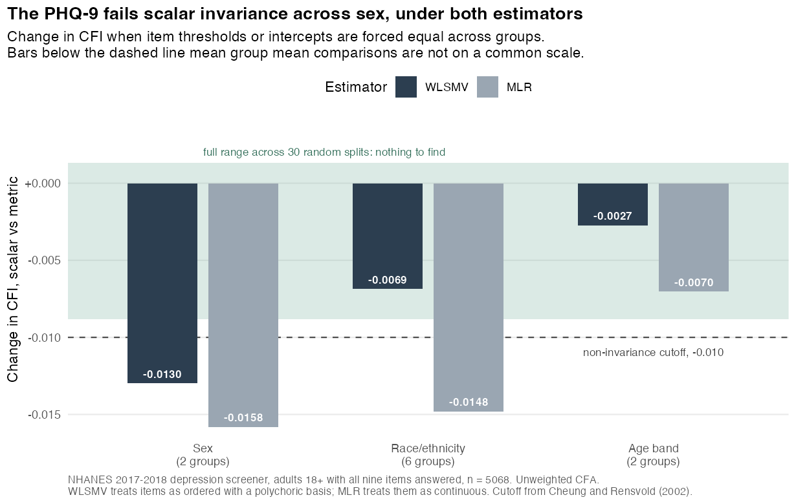
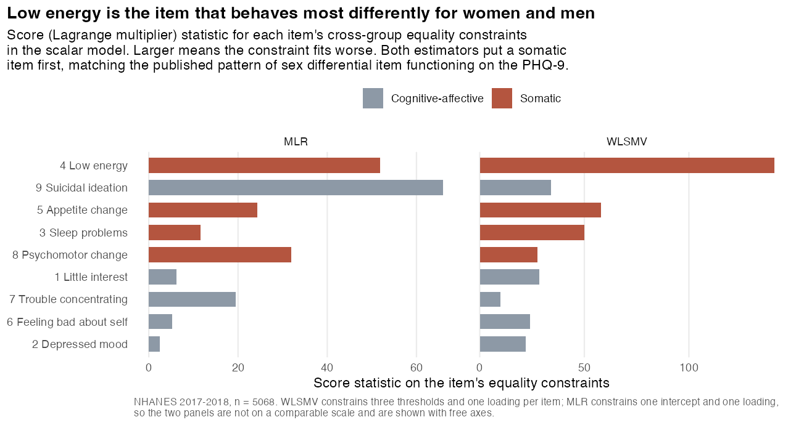
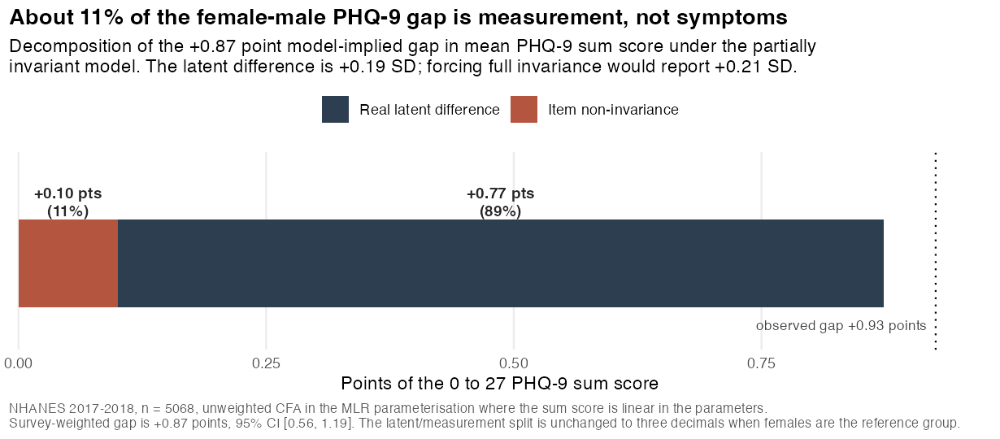

# Does the PHQ-9 mean the same thing to women and men?

Every study that compares a depression score between groups assumes the questionnaire
measures the same construct, on the same scale, in both. That assumption is called scalar
measurement invariance, it is testable, and it is usually not tested. This repo tests it on
the nine PHQ-9 items in NHANES 2017-2018 and then quantifies what the failure costs a naive
group comparison.

**Headline: the PHQ-9 fails scalar invariance across sex, and one somatic item is
responsible.** Forcing the item thresholds equal for women and men drops CFI by 0.0130 under
WLSMV and 0.0158 under MLR, both past the conventional 0.010 cutoff. Item 4, "feeling tired
or having little energy", is the single worst offender under both estimators. About **11% of
the observed female-male gap in PHQ-9 sum scores is measurement, not symptoms**: of the
+0.87 point model-implied gap, +0.77 points is a real latent difference and +0.10 points is
items behaving differently. A paper that assumed invariance would report a sex difference of
0.21 SD where the partially invariant model says 0.19 SD, an overstatement of about 10%.

Age band and race/ethnicity are the useful contrast. Across age (18-49 vs 50+) invariance
holds under both estimators. Across race/ethnicity (6 groups) the verdict **flips with the
estimator**: it holds under WLSMV (delta CFI -0.0069) and fails under MLR (-0.0148). If you
only ever ran the common shortcut of treating four-category Likert items as continuous, you
would publish the opposite conclusion about race that you would publish about sex.



The green band is the negative control: the full range of delta CFI across 30 random group
splits of the same respondents, where by construction there is nothing to find. The sex bars
sit outside it; the age bars sit inside it.

## Data

| | |
|---|---|
| Source | NHANES 2017-2018 (cycle J), public, no DUA, no login |
| Files | `DPQ_J.xpt` (depression screener, nine PHQ-9 items) and `DEMO_J.xpt` (demographics and survey design) |
| Vintage | pinned by sha256 in `00_download.R`, verified on download |
| Analytic sample | 5,068 adults 18+ with all nine items answered, representing 232,015,248 US adults under MEC exam weights |

The working URL is `https://wwwn.cdc.gov/Nchs/Data/Nhanes/Public/2017/DataFiles/DPQ_J.xpt`.
The older `/Nchs/Nhanes/2017-2018/DPQ_J.XPT` form still returns **HTTP 200** with a
20,905-byte CDC "Page Not Found" HTML page in the body. A downloader that trusts the status
code hands that HTML to `read_xpt`. `00_download.R` checks the SAS transport magic bytes
instead.

Three more traps handled explicitly, all in `01_audit.R`:

- The items code 7 as refused and 9 as don't know on a 0 to 3 scale. Recoded to `NA` before
  anything else touches them, because a stray 9 poisons every covariance in the model.
- `DPQ100` is in the same file and is the functional-impairment question, not a tenth symptom.
  It is excluded from the factor.
- Complete-case costs 465 of 5,533 adults (8.4%). Of those, 440 answered zero items and only
  25 answered some but not all. The 25 partial responders score higher on what they did
  answer (0.504 mean per item vs 0.360 for complete responders), so complete-case analysis
  drops a slightly more symptomatic group. With 25 people it cannot move the estimates, but
  it is stated rather than assumed.

Reliability in the analytic sample: Cronbach alpha 0.831, omega total 0.840. Mean PHQ-9
sum 3.24 (SD 4.24), 9.1% unweighted score 10 or higher. The n of 5,068 and the population
total of 232,015,248 match the earlier `nhanes-depression` analysis on the same cycle,
which is the intended consistency check.

## Method and why

**One-factor CFA of the nine items, fit two ways.** WLSMV with `ordered=` is the primary
specification: the items are four-category and badly skewed, with the sparsest cell (category
3 of the suicidal-ideation item) at 0.45%, so a polychoric basis is the defensible choice.
MLR treating the items as continuous is the common shortcut, reported alongside, precisely
because the shortcut is what most published analyses actually do. The two sets of fit
indices are never mixed in a table without labels; they are not comparable.

Baseline single-group fit: WLSMV CFI 0.981, RMSEA 0.059, SRMR 0.044. MLR CFI 0.934,
RMSEA 0.050, SRMR 0.042. Standardised loadings run 0.70 to 0.88 (WLSMV), so a single
factor is a reasonable summary before any group is involved.

**The sequence** is configural, then metric (equal loadings), then scalar (equal thresholds
under WLSMV, equal intercepts under MLR). Decision rule: scalar invariance is rejected if
CFI drops by more than 0.010 or RMSEA rises by more than 0.015 relative to the metric model
(Cheung and Rensvold 2002; Chen 2007).

**The chi-square difference test is not the rule.** At n = 5,068 it rejects everything: for
sex it gives chi-square diff 144.4 on 8 df, p < 2.2e-16, and it also rejects on random
splits where there is nothing to reject. It is printed in the log so you can see that, and
then ignored.

**Partial invariance** localises the failure with univariate score (Lagrange multiplier)
tests on the scalar model's cross-group equality constraints, then releases constraints one
item at a time, worst first, until the sequence passes.



Under WLSMV, freeing item 4 alone is enough (delta CFI -0.0074). Under MLR it takes items 9
and 4 (delta CFI -0.0081). Item 4 is flagged first or second by both. Three of the four
top-ranked items under WLSMV are somatic, which is the pattern the published PHQ-9 sex
differential-item-functioning literature reports.

**Survey design.** The CFA is unweighted, deliberately. Measurement invariance is a question
about the instrument's parameters, not about a population total, and `lavaan.survey` is not
installed here. The population-level quantity that the bias actually contaminates is
reported separately with the `survey` package on the correct MEC weights, SDMVSTRA strata
and SDMVPSU PSUs: the weighted female-male gap is +0.87 points, 95% CI [0.56, 1.19],
p = 3.1e-05. No population representativeness is claimed for the CFA itself.

## The consequence



Under the partially invariant model the sum-score gap decomposes exactly, because in the MLR
parameterisation the expected sum is linear in the parameters:

```
E[sum | group] = sum(intercepts) + sum(loadings) * latent mean
```

| | |
|---|---|
| Observed female-male gap, unweighted | +0.93 points |
| Model-implied gap, partial scalar model | +0.87 points |
| of which real latent difference | +0.77 points (89%) |
| of which item non-invariance | +0.10 points (11%) |
| Latent difference, partial model | +0.190 SD |
| Latent difference, forcing full invariance | +0.208 SD (9.5% larger) |
| Weighted gap, same 11% share applied | +0.10 of +0.87 points is measurement |

The split is unchanged to three decimals when females rather than males are the reference
group, which is worth checking because with `std.lv` the reference group's factor variance
is fixed at 1 and the split is not guaranteed to be reference invariant.

## Negative controls

Three of them, in `03_negative_control.R`. This is the part of the repo that earns the rest.

1. **Random grouping, 20 two-group splits and 10 six-group splits.** The identical sequence
   on arbitrary groups: **0 failures out of 60 model runs.** Worst scalar delta CFI seen
   was -0.0088 (MLR, six groups), median -0.0047 (MLR) and +0.0001 (WLSMV). The pipeline
   does not manufacture non-invariance out of sample noise, so the sex result is not an
   artifact of the cutoffs.
2. **Planted non-invariance.** Ordinal data simulated from a one-factor model with realistic
   loadings and thresholds, n = 2,500 per group, with one item's thresholds shifted in group
   B. The procedure ranks the planted item first with a wide margin at every detectable
   shift size:

   | threshold shift | chi-square rise (18 df) | worst-ranked item | planted item's score stat vs runner up |
   |---|---|---|---|
   | +0.0 | 11.3 | 4 Low energy | 1.8 vs 3.7 (rank 6/9, noise) |
   | +0.2 | 33.9 | **5 Appetite change** | 18.6 vs 4.9 |
   | +0.4 | 45.6 | **5 Appetite change** | 47.8 vs 7.4 |
   | +0.6 | 205.8 | **5 Appetite change** | 225.8 vs 9.1 |

   Note the criterion here is chi-square and the score ranking, not delta CFI. Data generated
   from a true one-factor model fits so well that CFI is 1.000 at every rung, so delta CFI
   has no room to move. The 0.010 cutoff is a rule for approximate misfit in real data, not
   for a model that is correct by construction.

3. **Recovery of a known decomposition,** 20 replications. True latent gap 0.250 SD,
   recovered 0.242 (SD 0.039). True measurement part 0.300 points, recovered 0.297
   (SD 0.025). True measurement share 15.9%, recovered 16.5%. The decomposition is not
   inventing the bias it reports.

**The simulated control caught a real bug and changed the headline.** lavaan's multigroup
default for ordered indicators frees the latent response intercepts in every group but the
first as soon as thresholds are constrained, and a free intercept absorbs a threshold shift
on the same item exactly. Threshold invariance then becomes untestable and the model reports
that it holds no matter what. Before the fix, a planted +0.6 threshold shift produced a
chi-square rise of 9 on 9 df and a score statistic of 5 for the guilty item, indistinguishable
from noise. After fixing the intercepts at zero so location is carried by the thresholds
alone (Wu and Estabrook 2016), the same shift gives a rise of 206 on 18 df and a score
statistic of 226 against 9 for the runner up. The WLSMV verdict for sex went from "passes"
to "fails" once the model was identified correctly.

## Running it

```bash
./run_all.sh          # tests, download, audit, invariance, controls, figures
RSCRIPT=/usr/local/bin/Rscript ./run_all.sh
```

R 4.5.1 with `lavaan`, `psych`, `survey`, `haven`, `dplyr`, `ggplot2`, `tidyr`. About 90
seconds end to end; it fits roughly 130 models. `Rscript tests.R` alone runs the six
assert-based tests. Raw XPT files are gitignored and refetched by `00_download.R`.

```
R/invariance.R           all the logic: recode, model specs, invariance sequence,
                         fit_table decision rule, score tests, gap decomposition
00_download.R            fetch and verify the two XPT files
01_audit.R               row counts, special codes, missingness, sparsity, reliability
02_invariance.R          the sequence, partial invariance, the consequence, weighted gap
03_negative_control.R    random splits, planted non-invariance, parameter recovery
04_report.R              three figures and three CSV tables
tests.R                  assert-based tests
output/                  figures, tables, and the full logs of every script
```

## Limitations

- **The CFA is unweighted.** Defensible for a measurement question, but it means the
  invariance result describes the 5,068 respondents, not the 232 million adults they
  represent. A weighted CFA would need `lavaan.survey` or a replicate-weight bootstrap.
- **Two age bands and six race/ethnicity categories, not more.** Finer bands thin the cells
  on the suicidal-ideation item, where category 3 is already 0.45% of the sample. Any
  invariance result across a group with an empty response category is not interpretable, so
  the bands are coarse on purpose.
- **`semTools` is not installed here**, so the ordinal sequence is built directly with
  lavaan's `group.equal` plus explicit zero intercepts rather than `measEq.syntax`. That
  reproduces the Wu and Estabrook identification for the rungs tested, but it does not test
  their full sequence including residual-variance invariance.
- **11% is a point estimate with no interval.** Getting a CI on the measurement share would
  need a bootstrap over the whole partial-invariance search, including the item-selection
  step, which is the honest way to do it and is not done here.
- **Partial invariance found by forward search is data-driven.** The items released were
  chosen by their score statistics in this sample. That the somatic pattern matches prior
  literature is reassuring, not confirmatory.
- **Sex is the NHANES `RIAGENDR` binary.** It is what the file contains; it is not a
  measure of gender.

## References

- Cheung and Rensvold (2002), *Structural Equation Modeling* 9(2): the 0.010 delta CFI cutoff.
- Chen (2007), *Structural Equation Modeling* 14(3): the 0.015 delta RMSEA cutoff.
- Wu and Estabrook (2016), *Psychometrika* 81: identification of invariance models for
  ordered categorical indicators.
