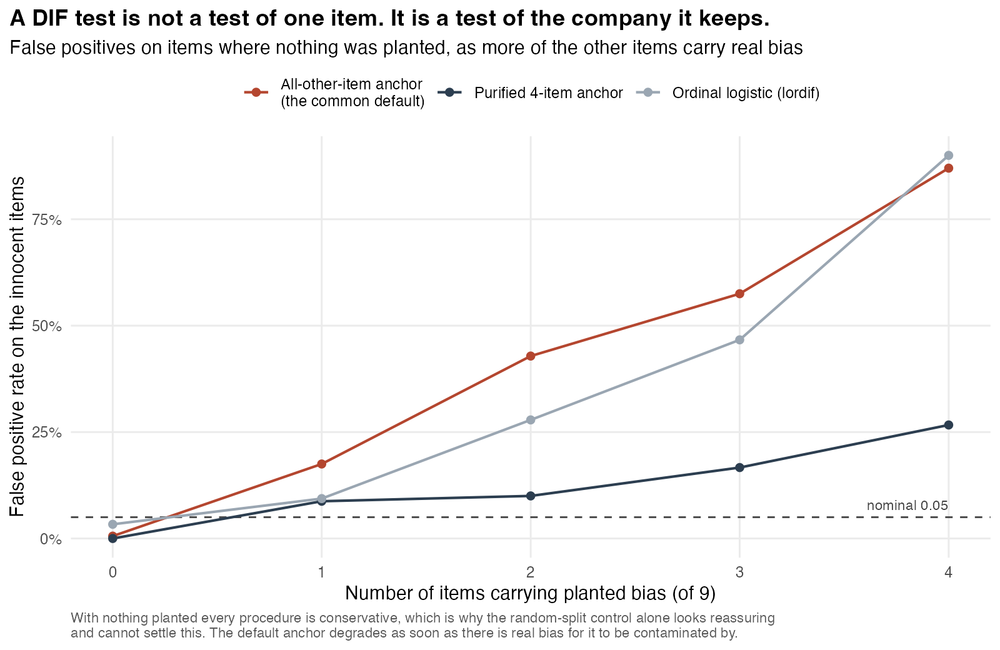
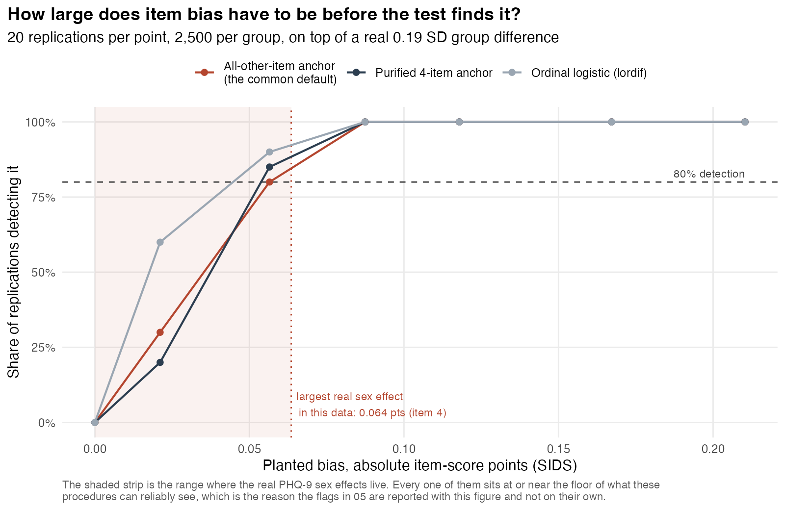

# Does the PHQ-9 mean the same thing to women and men?

Every study that compares a depression score between groups assumes the questionnaire
measures the same construct, on the same scale, in both. That assumption is called scalar
measurement invariance, it is testable, and it is usually not tested. This repo tests it on
the nine PHQ-9 items in NHANES 2017-2018 and then quantifies what the failure costs a naive
group comparison.

**Headline: the PHQ-9 fails scalar invariance across sex, and one somatic item is
responsible.** Forcing the item thresholds equal for women and men drops CFI by 0.0130 under
WLSMV and 0.0158 under MLR, both past the conventional 0.010 cutoff. Item 4, "feeling tired
or having little energy", is the single worst offender under both estimators. About **11% of
the observed female-male gap in PHQ-9 sum scores is measurement, not symptoms**: of the
+0.87 point model-implied gap, +0.77 points is a real latent difference and +0.10 points is
items behaving differently. A paper that assumed invariance would report a sex difference of
0.21 SD where the partially invariant model says 0.19 SD, an overstatement of about 10%.

Age band and race/ethnicity are the useful contrast. Across age (18-49 vs 50+) invariance
holds under both estimators. Across race/ethnicity (6 groups) the verdict **flips with the
estimator**: it holds under WLSMV (delta CFI -0.0069) and fails under MLR (-0.0148). If you
only ever ran the common shortcut of treating four-category Likert items as continuous, you
would publish the opposite conclusion about race that you would publish about sex.


The green band is the negative control: the full range of delta CFI across 30 random group
splits of the same respondents, where by construction there is nothing to find. The sex bars
sit outside it; the age bars sit inside it.

## Data

| | |
|---|---|
| Source | NHANES 2017-2018 (cycle J), public, no DUA, no login |
| Files | `DPQ_J.xpt` (depression screener, nine PHQ-9 items) and `DEMO_J.xpt` (demographics and survey design) |
| Vintage | pinned by sha256 in `00_download.R`, verified on download |
| Analytic sample | 5,068 adults 18+ with all nine items answered, representing 232,015,248 US adults under MEC exam weights |

The working URL is `https://wwwn.cdc.gov/Nchs/Data/Nhanes/Public/2017/DataFiles/DPQ_J.xpt`.
The older `/Nchs/Nhanes/2017-2018/DPQ_J.XPT` form still returns **HTTP 200** with a
20,905-byte CDC "Page Not Found" HTML page in the body. A downloader that trusts the status
code hands that HTML to `read_xpt`. `00_download.R` checks the SAS transport magic bytes
instead.

Three more traps handled explicitly, all in `01_audit.R`:

- The items code 7 as refused and 9 as don't know on a 0 to 3 scale. Recoded to `NA` before
  anything else touches them, because a stray 9 poisons every covariance in the model.
- `DPQ100` is in the same file and is the functional-impairment question, not a tenth symptom.
  It is excluded from the factor.
- Complete-case costs 465 of 5,533 adults (8.4%). Of those, 440 answered zero items and only
  25 answered some but not all. The 25 partial responders score higher on what they did
  answer (0.504 mean per item vs 0.360 for complete responders), so complete-case analysis
  drops a slightly more symptomatic group. With 25 people it cannot move the estimates, but
  it is stated rather than assumed.

Reliability in the analytic sample: Cronbach alpha 0.831, omega total 0.840. Mean PHQ-9
sum 3.24 (SD 4.24), 9.1% unweighted score 10 or higher. The n of 5,068 and the population
total of 232,015,248 match the earlier `nhanes-depression` analysis on the same cycle,
which is the intended consistency check.

## Method and why

**One-factor CFA of the nine items, fit two ways.** WLSMV with `ordered=` is the primary
specification: the items are four-category and badly skewed, with the sparsest cell (category
3 of the suicidal-ideation item) at 0.45%, so a polychoric basis is the defensible choice.
MLR treating the items as continuous is the common shortcut, reported alongside, precisely
because the shortcut is what most published analyses actually do. The two sets of fit
indices are never mixed in a table without labels; they are not comparable.

Baseline single-group fit: WLSMV CFI 0.981, RMSEA 0.059, SRMR 0.044. MLR CFI 0.934,
RMSEA 0.050, SRMR 0.042. Standardised loadings run 0.70 to 0.88 (WLSMV), so a single
factor is a reasonable summary before any group is involved.

**The sequence** is configural, then metric (equal loadings), then scalar (equal thresholds
under WLSMV, equal intercepts under MLR). Decision rule: scalar invariance is rejected if
CFI drops by more than 0.010 or RMSEA rises by more than 0.015 relative to the metric model
(Cheung and Rensvold 2002; Chen 2007).

**The chi-square difference test is not the rule.** At n = 5,068 it rejects everything: for
sex it gives chi-square diff 144.4 on 8 df, p < 2.2e-16, and it also rejects on random
splits where there is nothing to reject. It is printed in the log so you can see that, and
then ignored.

**Partial invariance** localises the failure with univariate score (Lagrange multiplier)
tests on the scalar model's cross-group equality constraints, then releases constraints one
item at a time, worst first, until the sequence passes.


Under WLSMV, freeing item 4 alone is enough (delta CFI -0.0074). Under MLR it takes items 9
and 4 (delta CFI -0.0081). Item 4 is flagged first or second by both. Three of the four
top-ranked items under WLSMV are somatic, which is the pattern the published PHQ-9 sex
differential-item-functioning literature reports.

**Survey design.** The CFA is unweighted, deliberately. Measurement invariance is a question
about the instrument's parameters, not about a population total, and `lavaan.survey` is not
installed here. The population-level quantity that the bias actually contaminates is
reported separately with the `survey` package on the correct MEC weights, SDMVSTRA strata
and SDMVPSU PSUs: the weighted female-male gap is +0.87 points, 95% CI [0.56, 1.19],
p = 3.1e-05. No population representativeness is claimed for the CFA itself.

## The consequence


Under the partially invariant model the sum-score gap decomposes exactly, because in the MLR
parameterisation the expected sum is linear in the parameters:

```
E[sum | group] = sum(intercepts) + sum(loadings) * latent mean
```

| | |
|---|---|
| Observed female-male gap, unweighted | +0.93 points |
| Model-implied gap, partial scalar model | +0.87 points |
| of which real latent difference | +0.77 points (89%) |
| of which item non-invariance | +0.10 points (11%) |
| Latent difference, partial model | +0.190 SD |
| Latent difference, forcing full invariance | +0.208 SD (9.5% larger) |
| Weighted gap, same 11% share applied | +0.10 of +0.87 points is measurement |

The split is unchanged to three decimals when females rather than males are the reference
group, which is worth checking because with `std.lv` the reference group's factor variance
is fixed at 1 and the split is not guaranteed to be reference invariant.

## Negative controls

Three of them, in `03_negative_control.R`. This is the part of the repo that earns the rest.

1. **Random grouping, 20 two-group splits and 10 six-group splits.** The identical sequence
   on arbitrary groups: **0 failures out of 60 model runs.** Worst scalar delta CFI seen
   was -0.0088 (MLR, six groups), median -0.0047 (MLR) and +0.0001 (WLSMV). The pipeline
   does not manufacture non-invariance out of sample noise, so the sex result is not an
   artifact of the cutoffs.
2. **Planted non-invariance.** Ordinal data simulated from a one-factor model with realistic
   loadings and thresholds, n = 2,500 per group, with one item's thresholds shifted in group
   B. The procedure ranks the planted item first with a wide margin at every detectable
   shift size:

   | threshold shift | chi-square rise (18 df) | worst-ranked item | planted item's score stat vs runner up |
   |---|---|---|---|
   | +0.0 | 11.3 | 4 Low energy | 1.8 vs 3.7 (rank 6/9, noise) |
   | +0.2 | 33.9 | **5 Appetite change** | 18.6 vs 4.9 |
   | +0.4 | 45.6 | **5 Appetite change** | 47.8 vs 7.4 |
   | +0.6 | 205.8 | **5 Appetite change** | 225.8 vs 9.1 |

   Note the criterion here is chi-square and the score ranking, not delta CFI. Data generated
   from a true one-factor model fits so well that CFI is 1.000 at every rung, so delta CFI
   has no room to move. The 0.010 cutoff is a rule for approximate misfit in real data, not
   for a model that is correct by construction.

3. **Recovery of a known decomposition,** 20 replications. True latent gap 0.250 SD,
   recovered 0.242 (SD 0.039). True measurement part 0.300 points, recovered 0.297
   (SD 0.025). True measurement share 15.9%, recovered 16.5%. The decomposition is not
   inventing the bias it reports.

**The simulated control caught a real bug and changed the headline.** lavaan's multigroup
default for ordered indicators frees the latent response intercepts in every group but the
first as soon as thresholds are constrained, and a free intercept absorbs a threshold shift
on the same item exactly. Threshold invariance then becomes untestable and the model reports
that it holds no matter what. Before the fix, a planted +0.6 threshold shift produced a
chi-square rise of 9 on 9 df and a score statistic of 5 for the guilty item, indistinguishable
from noise. After fixing the intercepts at zero so location is carried by the thresholds
alone (Wu and Estabrook 2016), the same shift gives a rise of 206 on 18 df and a score
statistic of 226 against 9 for the runner up. The WLSMV verdict for sex went from "passes"
to "fails" once the model was identified correctly.

## The IRT extension: DIF by sex, and what the DIF test's own error rate is

The CFA above asks a global question: does constraining all nine items across sex degrade
fit. `05_grm_dif.R` fits a graded response model and asks a narrower one, item by item:
holding latent depression fixed, do women and men differ in their probability of endorsing
this item. That is the question the DIF literature actually asks, and unlike the CFA it
returns an effect size in raw item-score points, which at n = 5,068 is the only part of the
output carrying information.

**Five items flag, and every effect is small.** Against a purified four-item anchor
(items 1, 2, 3, 6), items 4, 5, 7, 8 and 9 flag after Benjamini-Hochberg correction. The
largest effect is item 4 ("little energy") at **-0.064 item-score points**, meaning that at
equal true depression a woman scores 0.064 points lower on a 0 to 3 item than a man. Item 5
(appetite) is -0.050. Both negative effects are somatic items. No item shifts an expected
score by even a tenth of a point.

**Which items flag depends on the anchor, and that is reported rather than hidden.** DIF is
defined relative to the items you assume clean. The all-other-item default flags 6 of 9.
Sweeping the anchor size from 1 to 6 moves the flagged set from six items to three:

| anchor size | items flagged |
|---|---|
| 1 to 3 | 1, 4, 5, 7, 8, 9 |
| 4 | 4, 5, 7, 8, 9 |
| 5 | 4, 5, 8, 9 |
| 6 | 4, 5, 9 |

Only **items 4, 5 and 9 survive every anchor size**. Those are the result; the rest are
findings about the anchor. A second, structurally different procedure (`lordif`, ordinal
logistic regression with its own iterative purification) flags 6 items, agreeing on 4, 5
and 9 — and its purification trace visibly oscillates rather than converging, which is the
same instability showing up inside a method that is supposed to have solved it.

### The error rate, which is the actual point

`06_dif_error_rate.R` measures what the procedure does when the answer is known. This is the
half that most DIF papers skip, and it changes how the section above should be read.

**Null, 30 random splits of the same respondents.** Nothing distinguishes two coin-flip
groups, so every flag is an error. All three procedures come in **under** nominal:

| procedure | false positives per item test | splits reporting at least one |
|---|---|---|
| all-other-item anchor | 0.004 (0.1x nominal) | 3% |
| purified 4-item anchor | 0.013 (0.3x nominal) | 7% |
| lordif | 0.022 (0.4x nominal) | 17% |

Benjamini-Hochberg across nine tests is strict, so the procedures are conservative, not
liberal. Adding a real 0.19 SD group difference in true depression with no item bias at all
does not change that (0.000, 0.000, 0.033).

**This is where the first draft of the analysis was wrong.** Seeing 6 of 9 items flag under
the default anchor, `05` originally explained it as anchor contamination and left it there.
The null runs above cannot support that explanation: they contain no real DIF, so there is
nothing available to contaminate an anchor with, and both procedures look fine. A control has
to contain the thing it is meant to control for. Section 4 of `06` is the condition that
actually tests the claim.



**Contamination, planting bias on a growing number of items.** False-positive rate on the
items where nothing was planted, at a 0.4 logit shift, 20 replications per condition:

| items carrying real bias | all-other anchor | purified anchor | lordif |
|---|---|---|---|
| 0 | 0.006 | 0.000 | 0.033 |
| 1 | 0.175 | 0.088 | 0.094 |
| 2 | 0.429 | 0.100 | 0.279 |
| 3 | 0.575 | 0.167 | 0.467 |
| 4 | **0.870** | **0.267** | **0.900** |

The default anchor's false-positive rate on innocent items rises from 0.006 to 0.870 as four
of nine items acquire real bias. The purified anchor rises to 0.267. That slope, not the
level, is the contamination, and it only appears in the one condition that contains real DIF.
Purification is not free either: with four guilty items, an average of 1.2 of them ended up
inside the anchor set, where they are never tested and are instead defining the scale every
other item is judged against.



**Planted, detection as a function of effect size.** Sweeping the shift rather than picking
one convenient size turns "I validated it" into a statement about limits. The 80% detection
thresholds:

| procedure | 80% detection at | in item-score points |
|---|---|---|
| all-other-item anchor | 0.20 logits | 0.057 |
| purified 4-item anchor | 0.19 logits | 0.054 |
| lordif | 0.17 logits | 0.045 |

**Read that against the finding.** The largest real sex effect in this data is 0.064
item-score points. The procedure that found it needs 0.054 points for 80% power. The real
effect clears the floor, but only just, and every other flagged item sits below or near it.
That is a substantially weaker claim than "five items show DIF across sex", and it is the
claim the evidence supports.

### IRT against CFA

`07_compare.R` puts the two methods side by side. Nothing is refit; everything is read from
the saved output of the earlier stages.

| item | somatic | CFA score stat | CFA rank | IRT chi-square | IRT rank | IRT | SIDS |
|---|---|---|---|---|---|---|---|
| 1 Little interest | | 28.4 | 5 | | | anchor | |
| 2 Depressed mood | | 21.9 | 8 | | | anchor | |
| 3 Sleep problems | yes | 50.1 | 3 | | | anchor | |
| 4 Low energy | yes | 140.8 | 1 | 20.1 | 2 | **DIF** | -0.064 |
| 5 Appetite change | yes | 58.1 | 2 | 30.5 | 1 | **DIF** | -0.050 |
| 6 Feeling bad about self | | 24.0 | 7 | | | anchor | |
| 7 Trouble concentrating | | 9.8 | 9 | 15.6 | 5 | **DIF** | +0.010 |
| 8 Psychomotor change | yes | 27.5 | 6 | 16.5 | 4 | **DIF** | +0.041 |
| 9 Suicidal ideation | | 34.1 | 4 | 18.0 | 3 | **DIF** | +0.024 |

The CFA released item 4 alone to reach partial scalar invariance; the IRT test flags item 4
too. Over the five items the IRT side actually tested the two rankings correlate at
Spearman +0.90, which with five points is descriptive rather than a test and is labelled that
way. The somatic reading holds under both: the CFA's mean score statistic is 69.1 for somatic
items against 23.6 for the rest, and both items whose bias runs against women (items 4 and 5)
are somatic.

Item 7 is the one genuine disagreement worth noting: it ranks last of nine on the CFA and
fifth on the IRT test, and its effect size is +0.010 points, the smallest in the table. It is
the kind of item that appears in a flagged list because n is large, not because anything is
wrong with it.

## Running it

```bash
./run_all.sh          # tests, download, audit, invariance, controls, figures
RSCRIPT=/usr/local/bin/Rscript ./run_all.sh
```

R 4.5.1 with `lavaan`, `psych`, `survey`, `haven`, `dplyr`, `ggplot2`, `tidyr`, and for the
IRT stages `mirt` and `lordif`. Stages 00 to 04 take about 90 seconds and fit roughly 130
models. Stage 06 is the slow one: roughly 350 multigroup graded response models, about 12
minutes on 10 cores, and it honours `N_SPLITS`, `N_REPS` and `N_CORES` if you want a smoke
run. `Rscript tests.R` alone runs the ten assert-based tests in about 20 seconds. Raw XPT
files are gitignored and refetched by `00_download.R`.

On macOS the `mirt` binary may fail to load with a `libtbb` symbol error coming from `qs2`;
`install.packages("qs2", type = "source")` fixes it.

```
R/invariance.R           all the logic: recode, model specs, invariance sequence,
                         fit_table decision rule, score tests, gap decomposition
00_download.R            fetch and verify the two XPT files
01_audit.R               row counts, special codes, missingness, sparsity, reliability
02_invariance.R          the sequence, partial invariance, the consequence, weighted gap
03_negative_control.R    random splits, planted non-invariance, parameter recovery
04_report.R              three figures and three CSV tables
R/grm.R                  the IRT logic: GRM fits, anchored and all-other DIF tests,
                         anchor purification, expected-score effect sizes, simulator
05_grm_dif.R             graded response model, DIF by sex, anchor sensitivity, lordif
06_dif_error_rate.R      the error rate: null splits, impact-only null, contamination
                         by number of biased items, detection curve across effect sizes
07_compare.R             IRT against CFA, read from saved output, nothing refit
08_dif_figures.R         two figures and three CSV tables for the IRT stages
tests.R                  assert-based tests
output/                  figures, tables, and the full logs of every script
```

## Limitations

- **The CFA is unweighted.** Defensible for a measurement question, but it means the
  invariance result describes the 5,068 respondents, not the 232 million adults they
  represent. A weighted CFA would need `lavaan.survey` or a replicate-weight bootstrap.
- **Two age bands and six race/ethnicity categories, not more.** Finer bands thin the cells
  on the suicidal-ideation item, where category 3 is already 0.45% of the sample. Any
  invariance result across a group with an empty response category is not interpretable, so
  the bands are coarse on purpose.
- **`semTools` is not installed here**, so the ordinal sequence is built directly with
  lavaan's `group.equal` plus explicit zero intercepts rather than `measEq.syntax`. That
  reproduces the Wu and Estabrook identification for the rungs tested, but it does not test
  their full sequence including residual-variance invariance.
- **11% is a point estimate with no interval.** Getting a CI on the measurement share would
  need a bootstrap over the whole partial-invariance search, including the item-selection
  step, which is the honest way to do it and is not done here.
- **Partial invariance found by forward search is data-driven.** The items released were
  chosen by their score statistics in this sample. That the somatic pattern matches prior
  literature is reassuring, not confirmatory.
- **Sex is the NHANES `RIAGENDR` binary.** It is what the file contains; it is not a
  measure of gender.
- **The DIF flags sit close to the detection floor.** The largest real effect (0.064
  item-score points) barely clears the 0.054 needed for 80% power. Items 7, 8 and 9 have
  effects at or below the floor, so their flags should be read as "this procedure cannot
  resolve an effect this small reliably", not as findings.
- **The contamination result is about this instrument's geometry.** Nine items, four
  categories, these discriminations. The 0.006 to 0.870 slope should not be quoted as a
  general property of all-other-item anchors on other scales.
- **The anchor is chosen statistically, not substantively.** A content-based argument for
  which PHQ-9 items are clean across sex would beat any purification rule, and would turn
  the anchor sweep from a result into a sensitivity check.
- **The IRT stages are unweighted too**, for the same reason and with the same limitation as
  the CFA.

## References

- Cheung and Rensvold (2002), *Structural Equation Modeling* 9(2): the 0.010 delta CFI cutoff.
- Chen (2007), *Structural Equation Modeling* 14(3): the 0.015 delta RMSEA cutoff.
- Wu and Estabrook (2016), *Psychometrika* 81: identification of invariance models for
  ordered categorical indicators.
- Samejima (1969): the graded response model.
- Woods (2009), *Applied Psychological Measurement* 33: rank-based anchor selection for DIF.
- Choi, Gibbons and Crane (2011), *Journal of Statistical Software* 39: `lordif`.
- Meade (2010), *Journal of Applied Psychology* 95: expected-score DIF effect sizes (SIDS,
  ESSD).
